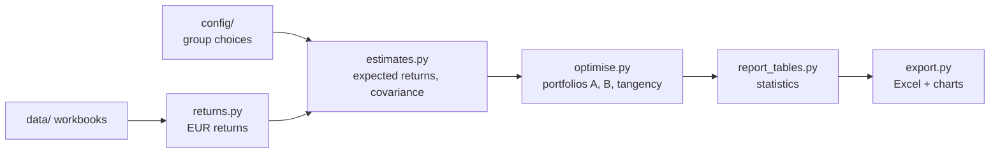

# FIN42350 portfolio optimiser

Code for the FIN42350 Capital Markets and Instruments group project (UCD Smurfit). From our price data it estimates the expected return and risk of every asset, then finds the best portfolio for the client's EUR 1,000,000 under the rules in our notes. It writes one Excel workbook and three charts used in the report.

> This repository holds the code only. The input data (`data/`) contains licensed Bloomberg values and is not published; it was submitted with the report. Place the input files in `data/` to run the code.

## Quick start

Install [git](https://git-scm.com) and [uv](https://docs.astral.sh/uv/), copy the input files into `data/`, then:

```bash
git clone https://github.com/andreasalexandrou21/FIN42350-portfolio-optimiser-code.git
cd FIN42350-portfolio-optimiser-code
uv sync                               # installs Python 3.12 and every package
uv run pytest                         # checks, should all pass
uv run python -m fin42350_portfolio   # runs everything, writes outputs/
```

Results land in `outputs/`; rerun after changing `config/`.

## How it works



| File | What it does | BKM chapter |
|---|---|---|
| `config.py` | Reads `config/params.toml` and `config/initial_weights.csv`. Stops if any value or its source is blank. | |
| `load.py` | Reads the Excel workbooks and the raw zip (ECB and FRED files). Never changes them. | |
| `returns.py` | Converts weekly local prices to EUR with the ECB rate for that Friday (Taiwan dollar via USD). Computes weekly returns and the weekly risk-free return. Lists every missing price. | ch.5 |
| `estimates.py` | Beta of each asset against the market index. Expected returns. Covariance matrix of weekly returns x52. Historical mean, sd and Sharpe ratio for comparison. | ch.5, 7, 8, 9, 14, 23 |
| `optimise.py` | Builds the weight limits from the asset list, then solves portfolios A, B, the tangency portfolio and the efficient frontier. | ch.7 |
| `report_tables.py` | Expected return, sd, Sharpe, beta, Treynor per portfolio; weights by class, sector and region; each asset's share of risk. | ch.6, 7, 8, 24 |
| `export.py` | Writes the workbook and charts. | |
| `__main__.py` | Runs everything in order and prints a summary. | |

### Expected returns

| Asset | Method |
|---|---|
| Stocks (P01 to P30) | CAPM: rf + beta x market risk premium |
| Bunds (N01), EUR corporates (N03) | Yield to maturity from the `Bond_stats` sheet |
| US Treasuries EUR-hedged (N05) | USD yield + (EUR rate - USD rate), the hedge adjustment |
| Cash (N07) | EUR STR |
| Gold (N09) | CAPM or historical average (config setting) |

The risk-free rate is the latest EUR STR in the data: 2.189% on 11 Sep 2026. Cash has zero risk in the covariance matrix.

## The assets

- **P01 to P30**: our 30 stocks, 6 per sector (IT, Health Care, Consumer Discretionary, Energy, Financials), 2 per region (US, Europe, Asia) in each sector.
- **N01** German Bunds, **N03** EUR corporate bonds, **N05** US Treasuries (EUR-hedged), **N07** cash, **N09** gold.
- **Market index**: STOXX Global Total Market net return in EUR (`TW1R Index`), used only to measure betas. It includes emerging markets (China, Taiwan, Korea, Poland).

## The portfolios

| Name | What it is |
|---|---|
| **w0** | Initial portfolio: our judgement weights in `config/initial_weights.csv`. |
| **A** | Main result. Highest expected return with no more risk than w0. |
| **B** | Robustness check. Lowest risk with at least w0's expected return. |
| **tangency** | Highest Sharpe ratio under the same rules. |

The **frontier** is the lowest possible risk at 50 target returns, from the safest allowed portfolio to the highest-return one.

### Rules every portfolio follows

| Rule | Range |
|---|---|
| Fully invested, no short selling | weights add to 100%, none negative |
| Equities / bonds / cash / gold | 75-85% / 10-20% / 2-5% / 0-5% |
| Each stock / each bond fund | 1-10% / 2-15% |
| Each sector / each region | 10-30% / 20-45% of the equity part |

### Data choices

- Weekly Friday prices, 27 Aug 2021 to 28 Aug 2026, converted to EUR with ECB rates.
- A missing price removes the two returns around it, for every asset, so all assets use the same weeks: 253 of 261. The gaps are TSMC's four Lunar New Year weeks, when Taiwan's exchange was closed.
- Portfolio beta counts cash as beta 0, matching its zero risk.

## Group settings (`config/`)

These are the numbers the code cannot compute from the data. Each has a `source`; the program refuses to run if a value or its source is blank. Rates are decimals (0.0505 = 5.05%).

| Setting | Value | Status |
|---|---|---|
| `market_risk_premium` | 0.0505 | **Decided.** J.P. Morgan 2026 Long-Term Capital Market Assumptions, euro: world equities 7.35% minus euro cash 2.30%. |
| `market` | `TW1R Index` | **Decided.** STOXX Global Total Market. `SXW1R Index` (Global 1800, developed only) is in the same file. |
| `gold_method` | `capm` | **To decide.** CAPM gives gold about 2.7% a year; the 5-year historical average is 19.2%. |
| `hedge_r_eur` | 0.02189 | **To decide.** EUR STR on 11 Sep 2026. |
| `hedge_r_usd` | 0.0362 | **To decide.** SOFR on 11 Sep 2026. |
| `initial_weights.csv` | 80/13/4/3 | **To decide.** Stocks/bonds/cash/gold, equal weights within stocks and within bonds. |

To try a setting without changing the real one, copy `config/` to another folder, edit the copy, and run with `--config that/folder/params.toml`.

## Outputs

**`results.xlsx`**:

| Sheet | Contents |
|---|---|
| Inputs | Per asset: expected return and method, beta, alpha, t-stats, R-squared, historical mean, sd, Sharpe. Every parameter with its source. |
| Cov | Covariance matrix of weekly EUR returns, x52. |
| Weights | Weights of w0, A, B and tangency, and EUR amounts on 1,000,000. |
| Stats | Portfolio statistics, weights by class, sector and region, each asset's share of variance. |
| Constraints | Every rule for every portfolio: value, limit, slack, whether it binds, and its shadow price. |
| Frontier | The 50 frontier points with their weights. |
| Data_gaps | Every missing price and the weeks dropped. |
| Run_info | When it ran, the git commit and the settings used. |

**Charts** (UCD colours, each as PNG and as vector PDF for Overleaf): `frontier` (frontier, capital allocation line, w0, A, B, tangency and every asset by class), `weights` and `risk_contribution` (w0 vs A per asset, grouped by sector and asset class).

## Checks (`uv run pytest`)

- The weekly EUR conversion matches the raw ECB and FRED rates for three currencies.
- The 253-week sample and the list of missing prices are as expected.
- The optimiser matches the textbook two-asset minimum-variance formula (BKM ch.7).
- Every portfolio obeys every rule, A is no riskier than w0, and the tangency portfolio has the best Sharpe ratio on the frontier.
- The program refuses to run with a blank setting.

## Repository layout

```
config/      group settings (the only files we normally edit)
data/        input workbooks and raw files (read only, not published)
src/         the code
tests/       automatic checks
outputs/     results workbook and charts (created by a run)
```

## Working together

```bash
git pull          # always first
git add -A
git commit -m "what you changed"
git push          # if rejected: git pull, then push again
```

Close any Excel file from the repo before pulling. Before pushing code: `uv run ruff check . && uv run ruff format . && uv run pytest`.

| Problem | Fix |
|---|---|
| `Config not ready: ... is missing` | Fill that field (and its source) in `config/`. |
| `PermissionError` when writing results | The results workbook is open in Excel. Close it. |
| `initial portfolio: ...` printed | The initial weights break that rule. The run continues, but fix the weights. |

## Glossary

- **Beta**: how much an asset moves with the market (1 = moves with it).
- **Covariance matrix**: how every pair of assets moves together; it gives portfolio risk.
- **Sharpe ratio**: (expected return - risk-free rate) / sd.
- **Treynor ratio**: (expected return - risk-free rate) / beta.
- **Efficient frontier**: the lowest risk possible for each level of expected return.
- **Binding constraint**: a rule the optimiser pushed right to its limit.
- **Shadow price (dual)**: how much the objective would improve if that limit were loosened slightly.
